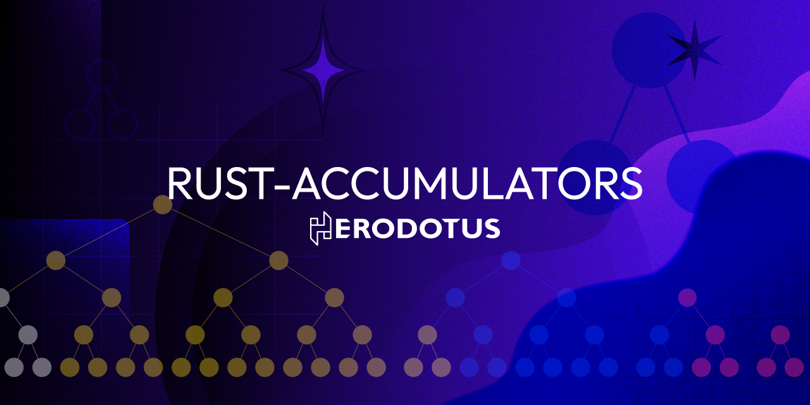

# Rust Accumulators

[](https://github.com/HerodotusDev/rust-mmr/actions/workflows/ci.yml)

Cryptographic accumulators with pluggable storage and hashing. Type-stated
MMRs (plain, stacked, draft, peaks-only; append-only, editable, nullifying),
self-contained proofs and multiproofs, and an incremental Merkle tree.
`no_std`-compatible core; misuse is a compile error wherever possible.

# Quick Start

Add dependency on `Cargo.toml`

```toml
accumulators = { version = "1.0.0-rc.1", features = ["all"] }
```

# Development

Test : `cargo test --features all`
Bench : `cargo bench --features all`

Documentation is generated from the source (`cargo doc --features all --open`);
the crate-level docs in `src/lib.rs` and the module docs in `src/mmr/` are the
authoritative API guide.

## Accumulators

### - MMR — `features = ["mmr"]`

A Merkle Mountain Range accumulator: sync (`Mmr`) and async (`AsyncMmr`)
handles over one pure state core, batched I/O (an append is one atomic write,
a proof one batched read), self-contained proofs with standalone verification,
stacking/branching (`stacked_mmr`), in-memory drafts with commit/discard
(`draft_mmr`), and shallow/deep nullification. Layout math lives in
`src/mmr/layout.rs`.

### - Incremental Merkle Tree — `features = ["incremental_merkle_tree"]`

An incremental Merkle tree accumulator with sparse storage and a zero-hash
ladder (proofs for every index within capacity). `src/merkle.rs`.

## Utils

### Hashers:

Hashing functions used for hashing inside accumulators — one trait
(`hashers::Hasher`) to implement your own.

- keccak (Solidity-compatible; `SolKeccak` alias): `features = ["keccak"]`
- poseidon: `features = ["poseidon"]`
- pedersen: `features = ["pedersen"]`
- blake (Cairo-flavored Blake2s): `features = ["blake"]`

### Stores:

Key value stores used for storing the accumulator data — implement the
`Store`/`AsyncStore` contract (two methods) to plug in rocksdb, redb, fjall,
postgres, redis, …

- memory: `features = ["memory"]`
- sqlite: `features = ["sqlite"]`

### Ids:

- uuid v4: `features = ["uuid_v4"]`
- uuid v7: `features = ["uuid_v7"]` (constructor additionally needs `std`)
- ulid: `features = ["ulid"]` (constructor additionally needs `std`)
- any custom `Copy` id type via the `ids::TreeId` trait

## Reference

- [accumulators - CoreMMR](https://github.com/HerodotusDev/accumulators)
- [cairo_lib - MMR](https://github.com/HerodotusDev/cairo-lib/tree/main/src/data_structures)

## License

`accumulators` is licensed under the [GNU General Public License v3.0](./LICENSE).

---

Herodotus Dev Ltd - 2024
